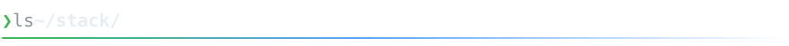

<picture>
  <source media="(prefers-color-scheme: dark)" srcset="assets/banner-dark.svg">
  <source media="(prefers-color-scheme: light)" srcset="assets/banner-light.svg">
  
</picture>

 

<picture>
  <source media="(prefers-color-scheme: dark)" srcset="assets/headers/a-propos-dark.svg">
  <source media="(prefers-color-scheme: light)" srcset="assets/headers/a-propos-light.svg">
  
</picture>

Administrateur / ingénieur système Linux. J'automatise et je fiabilise des infrastructures Linux.

 

<picture>
  <source media="(prefers-color-scheme: dark)" srcset="assets/headers/stack-dark.svg">
  <source media="(prefers-color-scheme: light)" srcset="assets/headers/stack-light.svg">
  
</picture>

<picture>
  <source media="(prefers-color-scheme: dark)" srcset="assets/stack-dark.svg">
  <source media="(prefers-color-scheme: light)" srcset="assets/stack-light.svg">
  
</picture>

 

<picture>
  <source media="(prefers-color-scheme: dark)" srcset="assets/headers/projets-dark.svg">
  <source media="(prefers-color-scheme: light)" srcset="assets/headers/projets-light.svg">
  
</picture>

<table>
  <tr>
    <td width="33%" align="center" valign="top">
       
      
      <h4><a href="https://github.com/KevinFIEFFE/linux-scripts">Linux Scripts</a></h4>
      Ma boîte à outils de scripts d'administration, de réseau et de sauvegarde, vérifiés par ShellCheck.
        
      <code>Bash</code> <code>RHEL</code>
        
    </td>
    <td width="33%" align="center" valign="top">
       
      
      <h4><a href="https://github.com/KevinFIEFFE/terraform-Hashicorp-Lab-">Terraform Lab</a></h4>
      Labo d'infrastructure as code avec Terraform.
        
      <code>Terraform</code>
       ⏳ en cours
        
    </td>
    <td width="33%" align="center" valign="top">
       
      
      <h4><a href="https://github.com/KevinFIEFFE/semences-vivantes">Semences Vivantes</a></h4>
      Blog sur les semences anciennes, la biodiversité potagère et le jardinage bio.
        
      <code>Astro</code> <code>Netlify</code>
       <a href="https://semences-vivantes.fr">semences-vivantes.fr ↗</a>
        
    </td>
  </tr>
</table>
