<picture>
  <source media="(prefers-color-scheme: dark)" srcset="assets/banner-dark.svg">
  <source media="(prefers-color-scheme: light)" srcset="assets/banner-light.svg">
  
</picture>

---

### 👋 À propos

Administrateur / ingénieur système Linux. J'automatise et je fiabilise des infrastructures Linux.

---

### 🧰 Stack

<table>
  <tr>
    <td><b>Systèmes & automatisation</b></td>
    <td>
      
      
      
      
      
    </td>
  </tr>
  <tr>
    <td><b>Conteneurs & IaC</b></td>
    <td>
      
      
    </td>
  </tr>
  <tr>
    <td><b>Scripting</b></td>
    <td>
      
      
      
      
    </td>
  </tr>
  <tr>
    <td><b>Web & hébergement</b></td>
    <td>
      
      
      
    </td>
  </tr>
</table>

---

### 🚀 Projets

<table>
  <tr>
    <td width="33%" valign="top">
      <h4>🐧 <a href="https://github.com/KevinFIEFFE/linux-scripts">Linux Scripts</a></h4>
      Ma boîte à outils de scripts d'administration, de réseau et de sauvegarde, vérifiés par ShellCheck.  
      
      
    </td>
    <td width="33%" valign="top">
      <h4>🏗️ <a href="https://github.com/KevinFIEFFE/terraform-Hashicorp-Lab-">Terraform Lab</a></h4>
      Labo d'infrastructure as code avec Terraform.  
      
      
    </td>
    <td width="33%" valign="top">
      <h4>🌱 <a href="https://github.com/KevinFIEFFE/semences-vivantes">Semences Vivantes</a></h4>
      Blog sur les semences anciennes, la biodiversité potagère et le jardinage bio.  
      
        
      <a href="https://semences-vivantes.fr">🔗 semences-vivantes.fr</a>
    </td>
  </tr>
</table>
